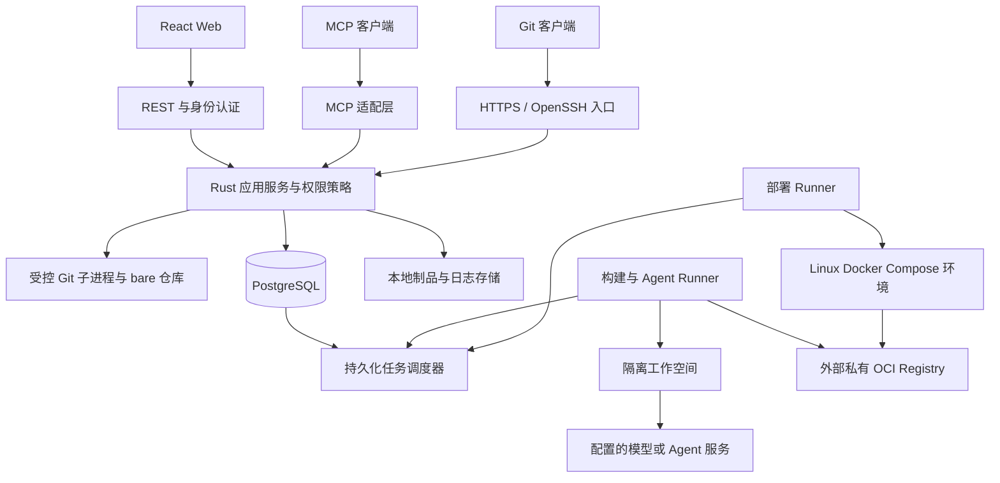

# MuseHub 技术架构

> 设计基线 0.1｜开发版本：0.20.0-rc6｜2026-11-19。所有容量、时延和恢复能力须在实现后验证。

## 1. 总体结构



控制面是模块化单体；调度循环与事件消费可先运行在同一服务进程。Runner 是独立进程和故障域。PostgreSQL 是业务状态的权威源，Git refs/objects 是代码的权威源，Registry digest 是镜像内容的权威标识，环境实际状态以部署 Runner 的观察为依据。

V1 不引入 Kafka、Redis、Elasticsearch 或 Kubernetes 作为必需基础设施。将来只有性能或组织边界证明需要时才拆服务。

## 2. 技术选型与模块边界

| 层 | 选择 | 责任与限制 |
|---|---|---|
| Rust HTTP | Tokio + Axum + Tower | REST、会话、限流、超时、追踪；版本在 M0 固定 |
| 数据访问 | SQLx + 仅 PostgreSQL | 显式 SQL、事务、up/down migration；服务入口执行 up 时使用 session advisory lock 串行化多实例启动；可连接外部 HA writer endpoint；运行时检查 `pg_is_in_recovery()` 并拒绝 standby 上的变更请求 |
| Git | 标准 Git CLI / git-http-backend / OpenSSH | 不拼 shell；参数数组、路径白名单、受限环境变量 |
| MCP | 官方 Rust SDK rmcp | 适配应用服务；协议能力按实际协商与测试公布 |
| Web | React + Vite + TypeScript + yarn | TanStack Query、i18n；制品可内嵌服务端 |
| 执行 | Linux + rootless 容器 + 专用 VM/主机 | 不把 Docker socket 交给不可信 job |
| 镜像构建 | 独立受控 rootless BuildKit worker | PR 无生产 Registry 写权限；构建后按摘要交付 |
| 制品 | 本地文件系统 BlobStore trait | V1 文件系统实现；支持外部共享挂载或 `mirror-musehub-storage.sh` 的异步单向 rsync 副本；S3 原生 BlobStore 与同步跨区域文件系统仍属后续 |
| 观测 | tracing + 结构化日志 + Prometheus 指标 | 不记录 token、模型凭据、完整私有源码输入 |

Axum 官方明确采用 Tokio/Hyper 并与 Tower 中间件集成；这是选型依据，不是本项目性能已得到证明。[Axum 文档](https://docs.rs/axum/latest/axum/)

建议 Cargo workspace：`domain` 定义实体和策略，`application` 编排用例，`store`/`git` 实现外部接口，`server` 负责传输，`runner` 负责执行，`agent` 负责适配，`mcp` 负责协议，`cli` 负责管理命令。允许先合并小 crate，避免纯为了目录整齐拆包。

## 3. Git 服务路径

### 3.1 HTTPS

反向代理终止 TLS → 服务端认证 PAT/会话策略 → 解析仓库 ID → 检查 read/write → 将受控 CGI 环境传入 `git-http-backend` → 流式转发。流量与子进程均有超时、并发和 pack 大小上限。认证 header 不直接传给 Git hook。

`git-http-backend` 提供 HTTP Git 服务，Rust 仍需实现鉴权、路由、进程管理及保护规则。[Git 官方文档](https://git-scm.com/docs/git-http-backend)

### 3.2 SSH

使用 OpenSSH 专用 git 用户与 forced command；`AuthorizedKeysCommand` 根据 key 指纹查询有效身份。禁止 PTY、端口转发、agent forwarding、任意 shell。forced command 只接受明确语法的 `git-upload-pack` / `git-receive-pack` 与仓库逻辑路径，转换为 UUID 存储路径，调用 Rust Git gateway。

所有 key 在启动会话时检查撤销状态；收到 push 的最终授权检查再次核对主体有效性。已经开始的只读下载无法承诺瞬间撤回已传输的数据。

### 3.3 分支保护与写入一致性

- HTTP、SSH、平台合并全部进入同一写入口；仓库 hooks 由平台管理，用户不能上传服务端任意 hook。
- 当前产品 `pre-receive` 阻止直接更新默认分支；允许创建新 tag，拒绝更新或删除既有 tag。完整的每 ref 权限、对象大小与非快进策略仍需补齐。
- HTTP/SSH receive-pack、平台合并与 AgentRun 发布通过 PostgreSQL transaction-scoped advisory lock 按仓库串行化，锁覆盖检查到 ref 更新；所有实例必须使用同一 PostgreSQL。`repository_lock_contention_e2e` 已验证两个独立连接池争用同一仓库时会串行等待。直接 filesystem Git 修改（例如手工运维命令）不受锁保护，生产运维必须经受控入口执行。物理多主机争用、共享文件系统语义和故障恢复仍需现场验收。
- SSH gateway 在 receive-pack 成功后比较 refs，并在同一仓库锁事务中写入 `git_ref_trigger_outbox`；控制面 dispatcher 用 `FOR UPDATE SKIP LOCKED` 派发，过期 processing 项可重领，pipeline trigger key 防止重复创建 run。Git ref 更新与 SQL outbox 仍非原子；控制面每 60 秒扫描 ready repositories 的 heads/tags，以 `(repo_id, git_ref, source_oid)` 唯一键幂等补入漏掉的 outbox 事件。首次扫描时没有历史 outbox 记录的现存 refs 会各触发一次；2026-11-19 已由专用隔离验收项目完成真实 SSH push → outbox → DinD Runner E2E，run/job/attempt 均成功；该证据不覆盖 artifacts/cache 或统一 T1。
- 合并先冻结 PR head H 和目标 base B，生成候选 merge commit M，CI 测试 M；通过且审批仍针对 H 时，以 old=B 的 CAS 更新目标到 M。B/H 变化则重建候选和检查。
- 普通 PR CI 结果不能代替合并候选 CI；发布构建再次针对实际已合并 commit。
- 所有写操作先保存 durable intent（repo、actor、old/new refs、操作 ID），再执行 Git。成功后更新 ledger 并产生 outbox 事件。
- Git 与数据库没有跨系统原子事务。进程崩溃时 intent 标为待对账；对账器比较 refs/objects 与记录，补事件或标记 failed/unknown，不能宣称 exactly-once。
- 成功 push 后 hook 事件丢失有 intent 和 ref 对账补偿；数据库不可用时新的受保护写入 fail closed。

Git 的 pre/post-receive hook 分别位于 ref 更新前后；post-receive 失败不能撤销已经接受的 push，因此关键拒绝必须发生在更新之前。[Git hooks 文档](https://git-scm.com/docs/githooks)

### 3.4 存储

目录 `repositories/<org_uuid>/<repo_uuid>.git`，逻辑重命名不搬动对象目录。禁止软链接逃逸和用户控制 Git config；限制本地 file 协议、外部 diff/filter、submodule 自动访问和 remote helper。定期 fsck 与 GC 在受控锁下执行。

普通 SHA-1 Git 仓库列为 V1 验收；LFS 和 SHA-256 仓库不进入首版保证范围。新 bare 仓库记录初始化 seed OID，只允许客户端 mirror push 在该 seed 仍为默认分支 head 时完成导入；导入后默认分支仍受保护。HTTP 与 SSH 的 receive/upload-pack 策略隐藏 `refs/musehub/*`，pre-receive 也拒绝客户端写入该内部命名空间。

多节点部署可将 bare Git 与制品目录挂载到同一外部共享文件系统，配置见 `deploy/docker-compose.shared-storage.yml`。文件系统必须实测跨主机可见性、Git 所需 POSIX 锁、同目录原子改名及节点重启后的持久性；`scripts/verify-shared-storage.sh` 可验双向可见性、原子改名及双机 `flock` 排他，但不证明崩溃恢复、存储复制或故障切换。没有共享 POSIX 文件系统时，`scripts/mirror-musehub-storage.sh` 和 systemd timer 提供 region A→B 的异步单向 Git/制品 rsync 副本，记录最后成功时间，并提供静默后的校验收敛模式；它不复制 PostgreSQL、不支持双写，连续模式不传播删除，最终校验/删除需业务静默并确认专用目标路径。副本延迟、故障隔离、提升和应用切流仍由运营方执行。`deploy/postgres-ha-cluster.yaml` 提供 CloudNativePG 三实例单区域集群参考，配置同步复制、failover quorum、跨 zone 反亲和及 writer LoadBalancer；2026-11-17 已在临时 k3d 集群验证同步确认记录在删除 primary Pod、自动提升副本后仍可读取，且集群恢复 3/3 Ready。该单机虚拟集群实验不证明物理节点隔离、网络分区 fencing、云存储耐久性或真实流量切换。`deploy/docker-compose.external-postgres.yml` 将 Compose 服务连接到稳定 writer endpoint。`/readyz` 通过 `pg_is_in_recovery()` 与 `transaction_read_only` 暴露 `primary/standby/read_only`，非可写主库返回 503 未就绪；变更 HTTP 请求在角色未知或不可写时 fail closed，启动初始化也拒绝只读端点。外部连接必须保留 session affinity，不能使用事务池化代理，因为迁移互斥锁使用 session advisory lock。此门禁限制错误路由，不替代 HA 编排器的仲裁与旧主机 fencing。外部 HA 管理器必须在提升前隔离旧主，否则两个互不连通的 writable primary 无法由应用层角色查询识别。`scripts/verify-postgres-primary.sh` 在切换后检查 writer endpoint 可写、直连的旧主不可写，并逐个检查 API 实例的 primary readiness 与版本一致性。生产 HA 仲裁、节点/网络 fencing、流量切换和跨故障域恢复仍依赖运营方提供的基础设施；仓库提供配置参考及角色门禁，不实现 Kubernetes/存储基础设施。

## 4. 应用服务、接口与事件

REST `/api/v1`、Web 和 MCP 均调用同一 use case；禁止 MCP 直接更新表或执行 shell。身份上下文包括 actor、发起用户、scope、org/repo 限制、trace ID。组织入口 `GET/POST /api/v1/orgs` 只暴露会话用户的活跃 membership；创建组织、owner membership 与 `org.create` 审计记录在同一事务提交。Web 工作区选择用于导航，后端 membership 检查仍是每个组织资源的授权边界。

GitHub OAuth App 使用授权码流程，数据库以短时一次性 state 和 HttpOnly browser-binding cookie 防止登录 CSRF；仅申请 `read:user`，access token 只用于读取 GitHub 用户数字 ID 与 login，不持久化。身份映射到 `https://github.com` issuer 与不可变数字 ID subject；不按邮箱自动认领既有账号。首次登录 provision 独立 human principal，但不自动授予组织 membership。配置需同时提供 client ID、client secret 与 callback URI；非 loopback callback 必须 HTTPS。真实 OAuth App 凭据及线上 callback 尚未验收；真实企业 IdP 互操作延期。

所有业务写操作在数据库事务中写主记录、审计摘要和 outbox。消费者按 `(consumer,event_id)` 去重。事件至少一次投递，外部副作用使用业务操作 ID、CAS、目标对账实现可重试。

AgentRun 启动事务先锁定 Issue 当前 revision，读取该版本的验收标准及 accepted plan，再将带版本/对象 ID 的 JSON 快照和用户请求写入 `agent_runs.task_message`；REST 与 MCP 共用同一构造逻辑。Issue 后续修订不会改变已排队任务的输入。计划正文由 Issue 页面显式编辑并接受；启动前端门禁只改善交互，服务端仍负责验证并冻结当前 accepted plan。

Live Codex 子进程使用 `codex exec --config approval_policy=\"never\" --config sandbox_mode=\"workspace-write\" --ignore-user-config --ephemeral`：不调用自动审批 reviewer，工作区命令仍受 `workspace-write` 沙箱限制；仅通过 `--add-dir` 将当前临时工作区解析出的 Git metadata 目录加入可写范围，以允许提交；忽略宿主 Codex 用户配置以避免个人配置影响隔离任务，CLI 登录凭据仍由 `CODEX_HOME` 提供。AgentRun token budget 依据 provider 回报的 usage 判定，不能保证单次调用在报告前不越额。

主要事件：`issue.revised`、`plan.accepted`、`agent.started/completed`、`git.refs_updated`、`pr.updated/merged`、`pipeline.completed`、`release.published`、`deployment.observed`。

事件携带资源 ID 和版本，避免在队列中复制源码、完整提示词或密钥。敏感上下文由消费者在授权后读取。消费者遇到永久失败进入失败表/死信状态，暴露原因和人工重试入口。

## 5. 持久化调度与 Runner

### 5.1 领取与执行

1. 应用在事务中创建 job、依赖边和 outbox；所有上游完成后 job 变为可领取。
2. Runner 经 mTLS 身份主动长轮询控制面，携带标签和剩余容量。
3. 数据库事务用 `FOR UPDATE SKIP LOCKED` 领取符合组织、信任等级、标签的 job。
4. 创建 attempt、递增 fencing token、保存 lease deadline，返回范围受限的执行配置。
5. Runner 心跳续约，上报进度和分块日志；完成回报必须携带 attempt ID 和 fencing token。
6. 只有当前有效 attempt 可以提交结果；迟到结果存诊断事件，不改变终态。

PostgreSQL 明确将 SKIP LOCKED 作为可用于队列式多消费者的机制，但它不提供通用一致读取视图。[PostgreSQL SELECT 文档](https://www.postgresql.org/docs/current/sql-select.html)

lease 初始 60 秒、每 15 秒续约、取消宽限 10 秒作为可配置初值，在 M0 故障实验调整。Runner 失联后不立即假定副作用不存在；读/构建 job 可新 attempt，部署/push 等先对账。Runner 在续约失败后禁止启动新步骤，并终止已运行沙箱；控制面撤销任务令牌。只有确认进程终止和外部副作用状态后才进入 canceled；失联且无法确认时保留 cancel_requested/unknown，不承诺分布式瞬时撤回。

### 5.2 信任分区

- PR job：不授予生产 secret、发布 Registry 写权限、环境修改权；工作流修改必须由可信 base 策略约束。
- 合并后 build job：仅访问构建所需 secret 与指定 Registry 仓库。
- Agent job：只允许指定仓库、工作分支和所需模型；用户代码/issue 文本不改变策略。
- Deployment job：在单独部署 Runner 上执行经过验证的声明式 manifest；不给 Agent 容器主机 root 或 Docker socket。

rootless 容器不是强多租户隔离保证。首版针对单组织可信内网试点；不同信任域使用不同 VM/主机 Runner。互联网不可信贡献者执行不在 V1 承诺内。

## 6. 流水线契约

仓库使用 `.musehub/workflows/*.yaml`。解析成版本化 AST，再验证权限、DAG 和资源上限。表达式只允许固定变量与简单条件，不执行模板代码。

```yaml
schema_version: 1
name: verify
on: [pull_request, push, manual]
jobs:
  test:
    runner: linux
    image: registry.internal.example/build/rust@sha256:<approved-digest>
    timeout_seconds: 1200
    steps:
      - checkout: {source: event_commit}
      - run: {command: "cargo test --locked", shell: sh}
    reports:
      junit: target/test-results.xml
  package:
    needs: [test]
    if: event_is_protected_branch_push
    runner: linux-build
    steps:
      - checkout: {source: event_commit}
      - build_image: {dockerfile: Dockerfile, registry_target: app}
```

这是 MuseHub 拟定语法示例，digest 占位符需替换，不能直接运行；普通 `cargo test` 不会自动生成 JUnit，项目若声明报告必须配置真实 reporter，否则报告缺失应失败/按显式策略处理。

V1 step 类型为 checkout、run、upload_artifact、build_image；支持 needs、受限 if、超时、手动重试、缓存与报告。不支持任意远端 `uses`。工作流执行使用固定来源 commit/hash；PR 不能修改自己的必需检查名单和信任权限。失败 run 的 workflow job 可通过通用 retry API 恢复：控制面为所有失败/跳过节点创建新 attempt，保留成功节点及历史日志；adapter 按 DAG 层仅执行队列节点，并要求每个依赖已成功或包含在本次队列中。

缓存 key 包含 org/repo、控制面赋予的 trust class、digest 固定的 job image、依赖锁文件 SHA-256、用户前缀和声明路径；不可信任务不能向可信 cache namespace 写入。当前 PR workflow adapter 由控制面固定为 `untrusted`。缓存放在共享 artifact root 的 `.workflow-cache`，不挂载进 job 容器；仅复制普通文件/目录，校验 tree SHA-256，拒绝符号链接，并在 miss、损坏或缓存 I/O 失败时回退到干净构建。条目限制为 64 MiB/8192 文件，TTL 7 天；每 trust namespace 最多 32 项，全局最多 512 项/4 GiB。备份与 storage mirror 均排除该临时缓存目录。日志上传序号去重、限制总量，制品先临时写入→计算 hash→原子重命名→登记可用。

## 7. Agent 适配与任务结果

平台提供受控进程适配契约：固定 argv，不拼 shell；输入通过受限文件/管道，事件输出 NDJSON；统一事件 `started/progress/needs_input/usage/artifact/completed/error`。实际 CLI 由适配器转换，不能假定第三方自带该协议。

每次执行冻结 IssueRevision、Plan、base SHA、Agent 配置版本、工具允许列表、运行镜像 digest、模型标识及提示词模板 hash。允许记录经过脱敏的必要输入输出，不收集或要求模型隐藏思维链。

最小输出：提交 OID、受限分支、变更文件清单、测试命令与结果、未完成验收条目。控制面独立核对远端 commit、非空 diff、分支范围和 PR；模型返回 completed 只能表示“请求验证”。没有改动的分析任务使用单独 task kind，不能冒充代码实现成功。

预算包含最大运行时长、最大工具轮次、模型 token 上限和可选费用上限。若第三方 CLI 无法报告或限制费用，该适配器标记“不支持硬费用上限”，只接受时间/轮次限制；要求硬预算的任务不得调度到该适配器。费用估计与账单分开展示。

等待用户输入时保存可恢复输出与上下文摘要，释放昂贵执行资源。恢复必须记录新的 attempt；不支持恢复的 CLI 从已提交检查点重建，不宣传任意进程断点续跑。

## 8. Release 与部署

Release 草稿选定实际 merge SHA；创建按 `(repo_id, version)` 幂等，同版本但字段不同的请求冲突；仓库内 tag 名全局唯一。发布过程验证必要构建、固定 commit、资产摘要及发布者权限，使用 Git `update-ref` compare-and-swap 创建 tag（已有 tag 仅在指向同一 commit 时视为可重试成功），再更新数据库为 published。若数据库更新失败，重试会核对并复用同一 tag，禁止将可漂移 tag 当作唯一来源。

V1 Docker Compose 部署支持单服务/简单应用 manifest、固定服务名、镜像 digest、环境变量引用、受管配置和健康检查。不接受任意 host bind mount、privileged、Docker socket；允许的端口/卷由环境模板规定。数据库生命周期与数据迁移不自动编排。

1. 生成目标计划：release、image digest、配置版本、secret 版本引用、目标环境和上次健康 deployment。
2. 测试环境按策略自动授权；受保护环境审批绑定计划 hash、审批者、期限及当前策略版本。
3. 每环境串行执行；Runner 保存 operation ID 与已观察状态，断线后根据该 ID 对账。
4. 拉取精确 digest，应用 Compose，检查实际容器 image 与健康端点，写入 observed digest/time。
5. 超时或结果不明进入 failed/unknown；首版回滚由用户明确触发，返回另一 deployment ID。

回滚只能恢复保留的应用镜像、配置与可用 secret 引用，不保证数据库/schema/外部服务回滚。Release 必须声明是否需要人工数据迁移；存在迁移前置条件时禁止无条件自动部署。已撤销 secret 不因回滚被自动复活。

## 9. 内网、鉴权与密钥

Web 使用 HttpOnly/SameSite=Lax 会话 cookie、CSRF 校验和 Argon2id 密码 hash；PAT 用带服务端 pepper 的 hash，支持过期和撤销。SSH 仅存公钥和指纹。

Web 登录支持单个部署级 OIDC Provider 的 Authorization Code + PKCE。服务启动时发现固定 issuer；回调使用 OIDC 库验证 ID token 签名、issuer、audience、有效期和 nonce，并额外校验多 audience 情况下的 `azp`。state、浏览器绑定值、nonce 与 PKCE verifier 有 10 分钟有效期，回调时在数据库中一次性消费。外部身份以 `(issuer, subject)` 唯一映射；不按邮箱自动绑定，不从身份 claims 推导组织或角色。已登录用户可在账户安全页把经过验证的身份绑定到自己的活跃 human principal；若该身份已绑定其他账号，操作以冲突拒绝。此流程不允许替其他用户绑定，也不会授予组织权限。HTTPS OIDC 回调自动启用 session cookie 的 Secure 属性；仅使用 HTTPS 的部署也应设置 `MUSEHUB_COOKIE_SECURE=1`。

实验性 SAML SP 发起登录在启动时读取固定的 IdP entity ID、metadata 文件和独立 PEM 签名证书；metadata 必须通过固定证书验签。ACS 固定为 HTTPS POST endpoint。RelayState、浏览器绑定值、AuthnRequest correlation、响应 ID 与 assertion ID 通过 PostgreSQL 一次性记录及 replay cache 在多进程间共享；不接受 unsolicited IdP-initiated response。登录主体只能通过管理员预绑定的 `(assertion issuer, NameID)` 映射到活跃 human principal，不按 email 自动认领或授予组织权限。SAML 依赖为 pre-1.0 且未声明外部安全审计，真实企业 IdP 互操作尚未验收，因此该能力仍属实验性。

组织级 SCIM 2.0 接口提供 Users 与 Groups 的列表、读取、创建、替换、局部更新和删除；每个组织使用独立的短期、可撤销 bearer token，token 只存哈希。令牌创建与撤销和对应审计事件在同一事务提交，审计仅记录令牌前缀，不包含明文凭据。外部 ID 与展示名称按组织隔离，User 停用只改变该组织 membership，不会全局禁用 principal；owner 不能由 SCIM 停用。SCIM 创建账号不会依据邮箱认领既有账号，也不自动创建登录凭据或 OIDC 映射。Users 支持 `userName`、`externalId`、`displayName`、`active` 等值过滤及白名单排序；Groups 支持 `displayName`、`externalId` 等值过滤及白名单排序。Group 成员以组织内复合外键关联该组织的 SCIM User，仅作为目录关系保存，不授予 MuseHub 权限。Bulk 提供有界子集：最多 100 项/1 MiB，顺序执行 Users/Groups 的创建、替换、PATCH 与删除，每项独立调用现有授权、事务和审计路径，并支持 `failOnErrors`；可解析同批次内先前成功创建的资源引用（含 Group 成员与资源路径），前向引用作为逐项错误返回；不支持密码同步。真实企业 IdP 兼容性仍需现场验收。

模型、Registry、Runner 和环境 secret 加密保存；加密主密钥从部署 secret/外部密钥管理注入，不与数据库备份同存。日志脱敏覆盖流式分块边界，但不能保证识别恶意编码泄露；使用最小授权和出口策略限制后果。

外部 URL、webhook、模型连接和健康检查均要防 SSRF；未实现受控内网目标登记前，Webhook 不允许访问内网。V1 Webhook 只允许 HTTPS 公网地址：创建订阅和每次投递前解析 DNS，拒绝私有、保留、loopback、link-local 等地址，并将连接固定到已校验的解析结果；禁用 HTTP 重定向，防止跳转绕过地址校验。签名密钥以 AES-256-GCM 加密存入数据库，主密钥通过 `MUSEHUB_WEBHOOK_ENCRYPTION_KEY` 提供，不能与数据库备份同存。未配置有效主密钥时投递 worker 暂停领取任务。

V1 MCP 支持 stdio 代理和预配置 Bearer token 的 Streamable HTTP 客户端；后者明确为受控客户端集成模式。要求 OAuth 自动发现/授权交互的客户端不列为 V1 已兼容，标准 OAuth 资源服务器集成在后续里程碑独立验收。

完全断网安装需要离线软件包、Agent 运行时、模型/网关、基础镜像、语言依赖镜像、内部证书和时间同步；安装检查逐项检测，不在运行时静默访问公网。

## 10. 运维与可靠性

- `/healthz` 仅进程存活；`/readyz` 检查数据库、Git 存储与版本兼容；外部模型不可用不应令 Git 服务整体不就绪。
- 指标包括请求延迟、Git 子进程/pack 拒绝、队列时长、lease 超时、过期回报、失败预算、制品上传失败、部署 unknown、备份年龄。
- 日志关联 request_id、actor_id、repo_id、operation_id、run_id、attempt_id；避免泄露原始认证材料。
- migration 由独立管理命令执行，先 dry-run/检查 SQL；生产部署前人工批准 migration，Web 启动仅检查 schema 兼容。
- V1 备份使用维护窗口：暂停写入与调度、停止/收敛执行回报、冻结 refs/制品写入，再备份数据库、仓库、blob 与所需 Registry 保留清单。恢复到隔离环境逐一验证 manifest。
- 恢复后旧租约失效、短期 token 撤销、部署逐项对账，避免旧 Runner 在新控制面继续执行。
- 跨组件计划切换先静默应用写入，在 PostgreSQL 写入持久化 `storage_recovery_barriers` UUID，再读取提交后的 WAL LSN；静默最终 Git/制品镜像状态携带同一 ID/LSN。DR 检查器要求镜像状态匹配，且 standby 已重放到该 LSN 并能读到 barrier；提升后还要求新 primary 可写且保留该行。此屏障只关联已确认的数据库与文件副本进度，不执行 writer 停止、PostgreSQL 复制、fencing、CNPG 提升或 API 流量切换。一次性单容器 E2E 验证了本地 WAL 追赶、滞后拒绝、提升和 down migration；真实跨主机/区域恢复仍未验收。
- 单区域 PostgreSQL HA 由外部 CloudNativePG 管理器负责同步复制和 quorum；跨区域参考路径由 Barman Cloud 归档/WAL 流转建立异地副本，目标为受控 RPO 的灾备而非同步多主。`deploy/postgres-dr-replica.yaml` 描述 Region B standby，`promote-cnpg-dr-replica.sh` 要求旧主配置已指向新主、存在 demotion token 且运营方确认完成旧区域 fencing 后才申请提升。旧主 fencing、对象存储耐久性、跨区 DNS/API 切流和 PITR 均属于基础设施/运维职责，配置尚未在真实多区域环境验收。
- 共享 Git/制品文件系统 overlay 只连接外部提供的共享挂载；`verify-shared-storage.sh survivor-check` 在源主机停机后检查幸存节点仍可读旧标记、写新标记、原子改名并获取锁。该探针验证挂载的可用性行为，不提供复制，也不代替存储服务端的复制/仲裁。
- 本地磁盘容量低于阈值时拒绝新写入并告警；制品清理采用引用检查和延迟删除，不删已发布/可回滚资产。

## 11. 首批 ADR

ADR-001：Rust 控制面 + 标准 Git，保证互操作优先。

ADR-002：PostgreSQL 持久队列 + outbox，避免首版多组件运维。

ADR-003：提交/测试/制品/部署证据决定成功，Agent 叙述不是事实源。

ADR-004：单主机 Compose 部署先行，稳定接口后增加 K8s。

ADR-005：原生 MCP 适配领域能力，禁止通用远程 shell MCP。

详细决策和调整触发条件见 [决策记录](07-decisions.md)。
