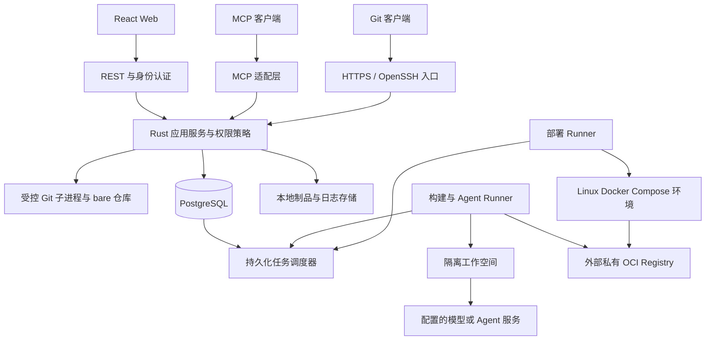

# MuseHub 技术架构

> 设计基线 0.1｜2026-10-30。所有容量、时延和恢复能力须在实现后验证。

## 1. 总体结构



控制面是模块化单体；调度循环与事件消费可先运行在同一服务进程。Runner 是独立进程和故障域。PostgreSQL 是业务状态的权威源，Git refs/objects 是代码的权威源，Registry digest 是镜像内容的权威标识，环境实际状态以部署 Runner 的观察为依据。

V1 不引入 Kafka、Redis、Elasticsearch 或 Kubernetes 作为必需基础设施。将来只有性能或组织边界证明需要时才拆服务。

## 2. 技术选型与模块边界

| 层 | 选择 | 责任与限制 |
|---|---|---|
| Rust HTTP | Tokio + Axum + Tower | REST、会话、限流、超时、追踪；版本在 M0 固定 |
| 数据访问 | SQLx + PostgreSQL | 显式 SQL、事务、up/down migration；不由 Web 启动隐式迁移 |
| Git | 标准 Git CLI / git-http-backend / OpenSSH | 不拼 shell；参数数组、路径白名单、受限环境变量 |
| MCP | 官方 Rust SDK rmcp | 适配应用服务；协议能力按实际协商与测试公布 |
| Web | React + Vite + TypeScript + yarn | TanStack Query、i18n；制品可内嵌服务端 |
| 执行 | Linux + rootless 容器 + 专用 VM/主机 | 不把 Docker socket 交给不可信 job |
| 镜像构建 | 独立受控 rootless BuildKit worker | PR 无生产 Registry 写权限；构建后按摘要交付 |
| 制品 | 本地文件系统 BlobStore trait | V1 先实现一种；S3 适配留后续 |
| 观测 | tracing + 结构化日志 + Prometheus 指标 | 不记录 token、模型凭据、完整私有源码输入 |

Axum 官方明确采用 Tokio/Hyper 并与 Tower 中间件集成；这是选型依据，不是本项目性能已得到证明。[Axum 文档](https://docs.rs/axum/latest/axum/)

建议 Cargo workspace：`domain` 定义实体和策略，`application` 编排用例，`store`/`git` 实现外部接口，`server` 负责传输，`runner` 负责执行，`agent` 负责适配，`mcp` 负责协议，`cli` 负责管理命令。允许先合并小 crate，避免纯为了目录整齐拆包。

## 3. Git 服务路径

### 3.1 HTTPS

反向代理终止 TLS → 服务端认证 PAT/会话策略 → 解析仓库 ID → 检查 read/write → 将受控 CGI 环境传入 `git-http-backend` → 流式转发。流量与子进程均有超时、并发和 pack 大小上限。认证 header 不直接传给 Git hook。

`git-http-backend` 提供 HTTP Git 服务，Rust 仍需实现鉴权、路由、进程管理及保护规则。[Git 官方文档](https://git-scm.com/docs/git-http-backend)

### 3.2 SSH

使用 OpenSSH 专用 git 用户与 forced command；`AuthorizedKeysCommand` 根据 key 指纹查询有效身份。禁止 PTY、端口转发、agent forwarding、任意 shell。forced command 只接受明确语法的 `git-upload-pack` / `git-receive-pack` 与仓库逻辑路径，转换为 UUID 存储路径，调用 Rust Git gateway。

所有 key 在启动会话时检查撤销状态；收到 push 的最终授权检查再次核对主体有效性。已经开始的只读下载无法承诺瞬间撤回已传输的数据。

### 3.3 分支保护与写入一致性

- HTTP、SSH、平台合并全部进入同一写入口；仓库 hooks 由平台管理，用户不能上传服务端任意 hook。
- `pre-receive` 核对每个 old/new/ref 的权限、保护规则、对象大小、删除与非快进限制；失败默认拒绝。
- V1 所有受控 ref 写入获取仓库级互斥锁，兼顾 receive-pack、平台合并与 GC。锁覆盖检查到 ref 更新；V1 禁止多机器直接共享同一可写仓库。
- 合并先冻结 PR head H 和目标 base B，生成候选 merge commit M，CI 测试 M；通过且审批仍针对 H 时，以 old=B 的 CAS 更新目标到 M。B/H 变化则重建候选和检查。
- 普通 PR CI 结果不能代替合并候选 CI；发布构建再次针对实际已合并 commit。
- 所有写操作先保存 durable intent（repo、actor、old/new refs、操作 ID），再执行 Git。成功后更新 ledger 并产生 outbox 事件。
- Git 与数据库没有跨系统原子事务。进程崩溃时 intent 标为待对账；对账器比较 refs/objects 与记录，补事件或标记 failed/unknown，不能宣称 exactly-once。
- 成功 push 后 hook 事件丢失有 intent 和 ref 对账补偿；数据库不可用时新的受保护写入 fail closed。

Git 的 pre/post-receive hook 分别位于 ref 更新前后；post-receive 失败不能撤销已经接受的 push，因此关键拒绝必须发生在更新之前。[Git hooks 文档](https://git-scm.com/docs/githooks)

### 3.4 存储

目录 `repositories/<org_uuid>/<repo_uuid>.git`，逻辑重命名不搬动对象目录。禁止软链接逃逸和用户控制 Git config；限制本地 file 协议、外部 diff/filter、submodule 自动访问和 remote helper。定期 fsck 与 GC 在受控锁下执行。

普通 SHA-1 Git 仓库列为 V1 验收；LFS 和 SHA-256 仓库不进入首版保证范围。客户端手动迁入 refs 时隐藏内部候选 refs；内部 refs 不允许普通 push/read。

## 4. 应用服务、接口与事件

REST `/api/v1`、Web 和 MCP 均调用同一 use case；禁止 MCP 直接更新表或执行 shell。身份上下文包括 actor、发起用户、scope、org/repo 限制、trace ID。

所有业务写操作在数据库事务中写主记录、审计摘要和 outbox。消费者按 `(consumer,event_id)` 去重。事件至少一次投递，外部副作用使用业务操作 ID、CAS、目标对账实现可重试。

主要事件：`issue.revised`、`plan.accepted`、`agent.started/completed`、`git.refs_updated`、`pr.updated/merged`、`pipeline.completed`、`release.published`、`deployment.observed`。

事件携带资源 ID 和版本，避免在队列中复制源码、完整提示词或密钥。敏感上下文由消费者在授权后读取。消费者遇到永久失败进入失败表/死信状态，暴露原因和人工重试入口。

## 5. 持久化调度与 Runner

### 5.1 领取与执行

1. 应用在事务中创建 job、依赖边和 outbox；所有上游完成后 job 变为可领取。
2. Runner 经 mTLS 身份主动长轮询控制面，携带标签和剩余容量。
3. 数据库事务用 `FOR UPDATE SKIP LOCKED` 领取符合组织、信任等级、标签的 job。
4. 创建 attempt、递增 fencing token、保存 lease deadline，返回范围受限的执行配置。
5. Runner 心跳续约，上报进度和分块日志；完成回报必须携带 attempt ID 和 fencing token。
6. 只有当前有效 attempt 可以提交结果；迟到结果存诊断事件，不改变终态。

PostgreSQL 明确将 SKIP LOCKED 作为可用于队列式多消费者的机制，但它不提供通用一致读取视图。[PostgreSQL SELECT 文档](https://www.postgresql.org/docs/current/sql-select.html)

lease 初始 60 秒、每 15 秒续约、取消宽限 10 秒作为可配置初值，在 M0 故障实验调整。Runner 失联后不立即假定副作用不存在；读/构建 job 可新 attempt，部署/push 等先对账。Runner 在续约失败后禁止启动新步骤，并终止已运行沙箱；控制面撤销任务令牌。只有确认进程终止和外部副作用状态后才进入 canceled；失联且无法确认时保留 cancel_requested/unknown，不承诺分布式瞬时撤回。

### 5.2 信任分区

- PR job：不授予生产 secret、发布 Registry 写权限、环境修改权；工作流修改必须由可信 base 策略约束。
- 合并后 build job：仅访问构建所需 secret 与指定 Registry 仓库。
- Agent job：只允许指定仓库、工作分支和所需模型；用户代码/issue 文本不改变策略。
- Deployment job：在单独部署 Runner 上执行经过验证的声明式 manifest；不给 Agent 容器主机 root 或 Docker socket。

rootless 容器不是强多租户隔离保证。首版针对单组织可信内网试点；不同信任域使用不同 VM/主机 Runner。互联网不可信贡献者执行不在 V1 承诺内。

## 6. 流水线契约

仓库使用 `.musehub/workflows/*.yaml`。解析成版本化 AST，再验证权限、DAG 和资源上限。表达式只允许固定变量与简单条件，不执行模板代码。

```yaml
schema_version: 1
name: verify
on: [pull_request, push, manual]
jobs:
  test:
    runner: linux
    image: registry.internal.example/build/rust@sha256:<approved-digest>
    timeout_seconds: 1200
    steps:
      - checkout: {source: event_commit}
      - run: {command: "cargo test --locked", shell: sh}
    reports:
      junit: target/test-results.xml
  package:
    needs: [test]
    if: event_is_protected_branch_push
    runner: linux-build
    steps:
      - checkout: {source: event_commit}
      - build_image: {dockerfile: Dockerfile, registry_target: app}
```

这是 MuseHub 拟定语法示例，digest 占位符需替换，不能直接运行；普通 `cargo test` 不会自动生成 JUnit，项目若声明报告必须配置真实 reporter，否则报告缺失应失败/按显式策略处理。

V1 step 类型为 checkout、run、upload_artifact、build_image；支持 needs、受限 if、超时、手动重试、缓存与报告。不支持任意远端 `uses`。工作流执行使用固定来源 commit/hash；PR 不能修改自己的必需检查名单和信任权限。

缓存 key 包含 org/repo、trust class、工具链、依赖锁文件 hash 和用户前缀；不可信任务不能向可信 cache namespace 写入。日志上传序号去重、限制总量，制品先临时写入→计算 hash→原子重命名→登记可用。

## 7. Agent 适配与任务结果

平台提供受控进程适配契约：固定 argv，不拼 shell；输入通过受限文件/管道，事件输出 NDJSON；统一事件 `started/progress/needs_input/usage/artifact/completed/error`。实际 CLI 由适配器转换，不能假定第三方自带该协议。

每次执行冻结 IssueRevision、Plan、base SHA、Agent 配置版本、工具允许列表、运行镜像 digest、模型标识及提示词模板 hash。允许记录经过脱敏的必要输入输出，不收集或要求模型隐藏思维链。

最小输出：提交 OID、受限分支、变更文件清单、测试命令与结果、未完成验收条目。控制面独立核对远端 commit、非空 diff、分支范围和 PR；模型返回 completed 只能表示“请求验证”。没有改动的分析任务使用单独 task kind，不能冒充代码实现成功。

预算包含最大运行时长、最大工具轮次、模型 token 上限和可选费用上限。若第三方 CLI 无法报告或限制费用，该适配器标记“不支持硬费用上限”，只接受时间/轮次限制；要求硬预算的任务不得调度到该适配器。费用估计与账单分开展示。

等待用户输入时保存可恢复输出与上下文摘要，释放昂贵执行资源。恢复必须记录新的 attempt；不支持恢复的 CLI 从已提交检查点重建，不宣传任意进程断点续跑。

## 8. Release 与部署

Release 草稿选定实际 merge SHA；发布过程验证必要构建、固定 tag、资产摘要及发布者权限，创建不可变 manifest。tag 和 DB 通过 operation ledger 对账；禁止用可漂移 tag 当作唯一来源。

V1 Docker Compose 部署支持单服务/简单应用 manifest、固定服务名、镜像 digest、环境变量引用、受管配置和健康检查。不接受任意 host bind mount、privileged、Docker socket；允许的端口/卷由环境模板规定。数据库生命周期与数据迁移不自动编排。

1. 生成目标计划：release、image digest、配置版本、secret 版本引用、目标环境和上次健康 deployment。
2. 测试环境按策略自动授权；受保护环境审批绑定计划 hash、审批者、期限及当前策略版本。
3. 每环境串行执行；Runner 保存 operation ID 与已观察状态，断线后根据该 ID 对账。
4. 拉取精确 digest，应用 Compose，检查实际容器 image 与健康端点，写入 observed digest/time。
5. 超时或结果不明进入 failed/unknown；首版回滚由用户明确触发，返回另一 deployment ID。

回滚只能恢复保留的应用镜像、配置与可用 secret 引用，不保证数据库/schema/外部服务回滚。Release 必须声明是否需要人工数据迁移；存在迁移前置条件时禁止无条件自动部署。已撤销 secret 不因回滚被自动复活。

## 9. 内网、鉴权与密钥

Web 使用 HttpOnly/Secure/SameSite cookie、CSRF 校验和 Argon2id 密码 hash；PAT 用带服务端 pepper 的 hash，支持过期和撤销。SSH 仅存公钥和指纹。

模型、Registry、Runner 和环境 secret 加密保存；加密主密钥从部署 secret/外部密钥管理注入，不与数据库备份同存。日志脱敏覆盖流式分块边界，但不能保证识别恶意编码泄露；使用最小授权和出口策略限制后果。

外部 URL、webhook、模型连接和健康检查均要防 SSRF；管理员登记允许的内网目标，禁止任意用户访问云 metadata、loopback 管理端点或越权网段。

V1 MCP 支持 stdio 代理和预配置 Bearer token 的 Streamable HTTP 客户端；后者明确为受控客户端集成模式。要求 OAuth 自动发现/授权交互的客户端不列为 V1 已兼容，标准 OAuth 资源服务器集成在后续里程碑独立验收。

完全断网安装需要离线软件包、Agent 运行时、模型/网关、基础镜像、语言依赖镜像、内部证书和时间同步；安装检查逐项检测，不在运行时静默访问公网。

## 10. 运维与可靠性

- `/healthz` 仅进程存活；`/readyz` 检查数据库、Git 存储与版本兼容；外部模型不可用不应令 Git 服务整体不就绪。
- 指标包括请求延迟、Git 子进程/pack 拒绝、队列时长、lease 超时、过期回报、失败预算、制品上传失败、部署 unknown、备份年龄。
- 日志关联 request_id、actor_id、repo_id、operation_id、run_id、attempt_id；避免泄露原始认证材料。
- migration 由独立管理命令执行，先 dry-run/检查 SQL；生产部署前人工批准 migration，Web 启动仅检查 schema 兼容。
- V1 备份使用维护窗口：暂停写入与调度、停止/收敛执行回报、冻结 refs/制品写入，再备份数据库、仓库、blob 与所需 Registry 保留清单。恢复到隔离环境逐一验证 manifest。
- 恢复后旧租约失效、短期 token 撤销、部署逐项对账，避免旧 Runner 在新控制面继续执行。
- 本地磁盘容量低于阈值时拒绝新写入并告警；制品清理采用引用检查和延迟删除，不删已发布/可回滚资产。

## 11. 首批 ADR

ADR-001：Rust 控制面 + 标准 Git，保证互操作优先。

ADR-002：PostgreSQL 持久队列 + outbox，避免首版多组件运维。

ADR-003：提交/测试/制品/部署证据决定成功，Agent 叙述不是事实源。

ADR-004：单主机 Compose 部署先行，稳定接口后增加 K8s。

ADR-005：原生 MCP 适配领域能力，禁止通用远程 shell MCP。

详细决策和调整触发条件见 [决策记录](07-decisions.md)。
