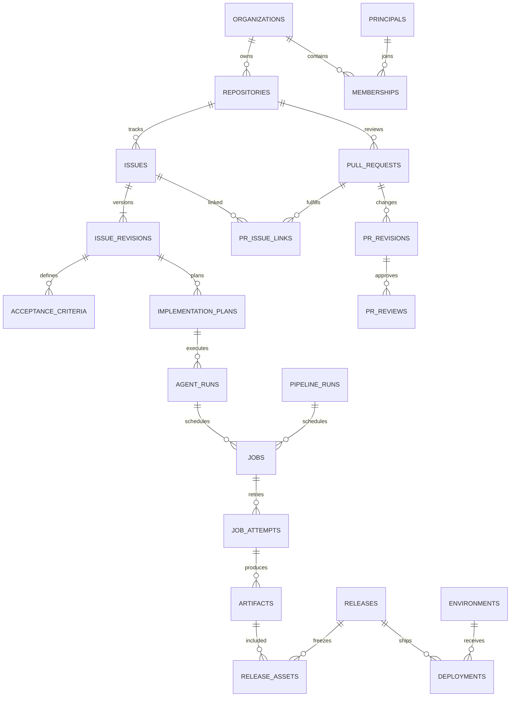

# MuseHub 数据库设计

> 设计基线 0.1｜2026-10-30。逻辑模型与关键约束供实施使用；不是已执行的数据库 schema。完整 DDL 在对应里程碑用成对 migration 落地并验证。

## 1. 通用约定

- 业务存储只支持 PostgreSQL，不提供 SQLite、MySQL 或其他数据库后端；所有表（包括关联表）都有 `id UUID PRIMARY KEY`、`created_at TIMESTAMPTZ NOT NULL DEFAULT CURRENT_TIMESTAMP`、`updated_at TIMESTAMPTZ NOT NULL DEFAULT CURRENT_TIMESTAMP`。ID 使用应用生成 UUIDv7，数据库 PK 保证唯一。
- `updated_at` 由数据库 BEFORE UPDATE trigger 维护；不可变记录禁止业务 UPDATE，保留其创建时间作为 updated_at。禁止依赖客户端自报时间作为租约/审批期限依据。
- 下列字典省略通用三列。字段默认 NOT NULL，`?` 表示 nullable；`FK` 表示外键。字符串状态使用 TEXT + CHECK，避免 PostgreSQL enum 演进成本。
- 表格未重复标类型的字段按约定展开：`*_id` 为 UUID，`*_at`/`*_until` 为 TIMESTAMPTZ，`row_version`/`policy_version`/`*_number`/`byte_length` 为 BIGINT，布尔显式 BOOL；name/slug/path/state/kind/ref/OID/hash 等其余标量为 TEXT（OID/hash 另受格式约束）。已标 JSONB 的字段按专用 schema 校验。
- 用户输入文本有长度限制；state、slug、ref、OID、digest、currency 等应用与数据库双重校验。OID 保存 `VARCHAR(64)`，实际长度按 repo.object_format 校验，V1 仅接受 sha1 的 40 位。
- 所有组织业务表携带 `org_id FK organizations`；仓库业务表同时有 `repo_id FK repositories`。父表建立 `UNIQUE(org_id,id)`，仓库对象建立 `UNIQUE(org_id,repo_id,id)`；子表用复合 FK 阻止跨组织/跨仓库引用，不能只靠 API 过滤。
- 身份表是全局表；组织内身份通过 membership 与 grant 授权。每个 FK 必须有以该列/复合列为前缀的索引；下表仅额外列出核心查询索引。
- 关系字段、状态、关键权限不藏进 JSONB；JSONB 用于版本化快照、工具配置、事件载荷、约束参数。每个 JSONB 入口有 schema 版本、大小限制和校验。
- 普通对象更新用 `row_version BIGINT DEFAULT 1` 乐观锁，客户端提交 expected_version；不可变快照不使用原地更新。
- 业务实体默认归档不物理删除；V1 不开放仓库硬删除。审计、执行和发布证据引用保留。生产数据删除另立保留策略流程。
- 使用参数化 SQL、白名单排序；分页按 `(created_at,id)` 或仓库内 number。唯一约束 `uk_<table>_<columns>`，普通索引 `idx_<table>_<columns>`。

## 2. 核心关系



图仅展示主干；完整字段与约束以下表为准。

## 3. 身份、组织与权限

| 表 | 字段（省略通用列） | 约束/索引 |
|---|---|---|
| principals | kind `human/service/agent`；handle TEXT；display_name TEXT；status `active/disabled`；row_version BIGINT | 全局 handle 规范化唯一；索引 status |
| user_credentials | principal_id FK；password_hash TEXT；password_changed_at TIMESTAMPTZ | principal_id 唯一；仅 human 可用，由服务验证；无明文密码 |
| sessions | principal_id FK；token_hash BYTEA；expires_at TIMESTAMPTZ；revoked_at?；last_seen_at? | token_hash 唯一；索引 principal_id、expires_at |
| organizations | slug TEXT；display_name TEXT；status TEXT；row_version BIGINT | 规范化 slug 唯一 |
| memberships | org_id FK；principal_id FK；role `owner/admin/member`；status TEXT | UNIQUE(org_id,principal_id)；最后一位 owner 不可移除（事务锁组织） |
| access_tokens | principal_id FK；org_id? FK；name TEXT；token_prefix TEXT；token_hash BYTEA；scopes TEXT[]；scope_mode `selected/all_accessible` DEFAULT selected；expires_at；revoked_at?；last_used_at?；bound_run_id? UUID | token_hash 唯一；org_id 为空只用于人类跨组织基础 token，仍逐资源授权；run 绑定由服务校验并可复合引用 |
| token_repository_grants | token_id FK；org_id FK；repo_id FK | UNIQUE(token_id,repo_id)；token 有限仓库模式必须列明授权，空列表不隐式全权 |
| ssh_keys | principal_id FK；name TEXT；public_key TEXT；fingerprint TEXT；revoked_at? | fingerprint 全局唯一；公钥格式/算法白名单 |
| repository_grants | org_id FK；repo_id FK；principal_id FK；role `reader/developer/maintainer` | UNIQUE(repo_id,principal_id)；索引 principal_id,repo_id |

PAT scopes 是能力集合，不替代对象授权；token_repository_grants 与 access_tokens.scopes 的交集决定权限。全仓库 token 需显式设置 scope_mode=`all_accessible`，默认 selected，禁止空 grants 被解释为无限权限。绑定任务的令牌必须 selected 且限定单仓库/分支，分支限制由运行上下文进一步约束。

## 4. 仓库与 Git 写入

| 表 | 字段 | 约束/索引 |
|---|---|---|
| repositories | org_id；slug；description；default_branch；storage_key；object_format `sha1`；state `creating/ready/failed/archived`；next_issue_number BIGINT；next_pr_number BIGINT；row_version | UNIQUE(org_id,slug)、UNIQUE(storage_key)；计数器在事务内 UPDATE RETURNING |
| branch_rules | org_id；repo_id；ref_pattern；require_review_count INT；required_checks JSONB；deny_force_push BOOL；deny_delete BOOL；allow_direct_push BOOL；policy_version BIGINT | UNIQUE(repo_id,ref_pattern)；多规则匹配取更严格策略，规则排序固定 |
| git_operations | org_id；repo_id；actor_id FK principals；kind；request_id；ref_updates JSONB；state `prepared/applied/reconciled/failed/unknown`；error_code?；row_version | UNIQUE(repo_id,request_id)；索引(state,updated_at,id)；完整 old/new/ref 快照与 fsync 策略 |

tag 保护可以复用 ref_pattern=`refs/tags/*`。首版不将 commits、trees、blobs 全量写入数据库；代码查询从 Git 读取，索引缓存可重建。内部候选 ref 必须带命名空间和访问隔离。

## 5. Issue、计划与讨论

| 表 | 字段 | 约束/索引 |
|---|---|---|
| issues | org_id；repo_id；number BIGINT；author_id FK；assignee_id? FK；state；current_revision_id? FK issue_revisions；resolution_reason?；row_version | UNIQUE(repo_id,number)；索引(repo_id,state,created_at,id)、(assignee_id,state) |
| issue_revisions | org_id；repo_id；issue_id FK；revision INT；title TEXT；body TEXT；author_id FK；content_hash CHAR(64) | UNIQUE(issue_id,revision)；不可变；current_revision 必须属于该 issue |
| acceptance_criteria | org_id；repo_id；issue_revision_id FK；ordinal INT；description TEXT；verification_method TEXT；required BOOL | UNIQUE(issue_revision_id,ordinal)；不可变；验收结果另记 evidence |
| labels | org_id；repo_id；name TEXT；color TEXT | UNIQUE(repo_id,name) |
| issue_labels | org_id；repo_id；issue_id FK；label_id FK | UNIQUE(issue_id,label_id)；两端必须同 repo |
| implementation_plans | org_id；repo_id；issue_revision_id FK；version INT；body TEXT；steps JSONB；state `draft/accepted/superseded`；accepted_by? FK；accepted_at?；content_hash CHAR(64) | UNIQUE(issue_revision_id,version)；accepted 后正文不可修改；接受者有效权限由服务核验 |
| comments | org_id；repo_id；issue_id? FK；pr_id? FK；author_id FK；body TEXT；pr_revision_id? FK；path? TEXT；side? `left/right`；line? INT；resolved_at?；resolved_by? FK；row_version | CHECK 恰好一个 issue_id/pr_id 非空；行评论必须绑定 pr_revision；索引(issue_id,created_at,id)、(pr_id,created_at,id) |
| acceptance_evidence | org_id；repo_id；criterion_id FK；pr_revision_id? FK；pipeline_run_id? FK；deployment_id? FK；artifact_id? FK；result `pass/fail/manual_required`；verified_by FK；summary TEXT | 至少一个可验证 evidence 引用；同 repo 约束；索引 criterion_id；记录不可变 |

issue_revisions 与 issues 有初始化循环：事务内先创建 issue（current_revision 为空）、插 revision、更新 current_revision；提交时 deferred constraint trigger 保证 ready issue 必有当前版本且归属正确。禁止未完成事务的对象对用户可见。

## 6. PR 与检查

| 表 | 字段 | 约束/索引 |
|---|---|---|
| pull_requests | org_id；repo_id；number；author_id FK；title；body；source_branch；target_branch；state；current_revision_id? FK；merged_commit_oid?；merged_by? FK；merged_at?；row_version | UNIQUE(repo_id,number)；索引(repo_id,state,created_at,id) |
| pr_revisions | org_id；repo_id；pr_id FK；sequence INT；base_oid；head_oid；candidate_merge_oid?；diff_digest；policy_version BIGINT | UNIQUE(pr_id,sequence)；不可变；同一 base/head 可在策略变更后有新 revision |
| pr_reviews | org_id；repo_id；pr_id FK；pr_revision_id FK；reviewer_id FK；decision `approve/request_changes/comment`；body | 索引(pr_revision_id,reviewer_id,created_at,id)；按每位审查者最新有效意见计算，不能把作者自己算批准 |
| pr_issue_links | org_id；repo_id；pr_id FK；issue_revision_id FK；relationship `implements/relates` | UNIQUE(pr_id,issue_revision_id,relationship)；实现必须指向确切需求版本 |
| check_runs | org_id；repo_id；pr_revision_id? FK；pipeline_run_id FK；name；subject_oid；policy_version BIGINT；state；conclusion?；completed_at? | UNIQUE(pipeline_run_id,name,subject_oid)；索引(repo_id,subject_oid,name)；写入只允许可信 Runner 路径 |

合并门禁需满足：当前 revision 的 head/base 未变化、候选 commit 的必需 checks 成功、当前策略匹配、足够独立审查、未解决阻塞讨论为零。不能简单取“该分支最近一个成功 pipeline”。

## 7. Agent 配置与运行

| 表 | 字段 | 约束/索引 |
|---|---|---|
| agent_profiles | org_id；service_principal_id FK；name；adapter_kind；config_version INT；config_snapshot JSONB；model_endpoint_ref?；credential_secret_id? FK secrets；capabilities JSONB；enabled BOOL；row_version | UNIQUE(org_id,name)；配置更新产生新 version，运行快照不随之变化 |
| agent_profile_grants | org_id；agent_profile_id FK；principal_id FK | UNIQUE(agent_profile_id,principal_id)；组织 owner 可管理但实际使用仍审计 |
| agent_runs | org_id；repo_id；issue_revision_id FK；plan_id FK；pr_id? FK；profile_id FK；requested_by FK；base_oid；work_branch；input_snapshot JSONB；state；time_limit_seconds INT；max_steps INT；token_limit? BIGINT；cost_limit_microusd? BIGINT；usage JSONB；result_commit_oid?；error_code?；row_version | work_branch 在 repo 内唯一；CHECK 限额非负；索引(repo_id,state,created_at,id) |
| agent_messages | org_id；repo_id；agent_run_id FK；sequence BIGINT；kind `input/progress/needs_input/summary/error`；author_id? FK；body TEXT；metadata JSONB | UNIQUE(agent_run_id,sequence)；限制长度；不保存隐藏推理过程 |

input_snapshot 保存 profile config version、Agent 程序版本、模型 ID、运行镜像摘要、提示词模板 hash、允许工具、凭据引用；不保存凭据明文。多轮恢复由 job_attempts 表达，新增需求版本应建立新 run。

## 8. 工作流、调度与制品

| 表 | 字段 | 约束/索引 |
|---|---|---|
| workflow_versions | org_id；repo_id；path；source_oid；content_hash；schema_version INT；definition JSONB | UNIQUE(repo_id,path,source_oid)；不可变 |
| pipeline_runs | org_id；repo_id；workflow_version_id FK；trigger_kind；trigger_event_id? FK outbox_events；requested_by FK；source_oid；pr_revision_id? FK；trust_class；state；row_version | UNIQUE(workflow_version_id,trigger_event_id) WHERE event 非空；索引(repo_id,created_at,id) |
| jobs | org_id；repo_id；pipeline_run_id? FK；agent_run_id? FK；deployment_id? FK；job_key；kind；state；priority INT；trust_class；required_labels TEXT[]；available_at；timeout_seconds INT；max_attempts INT；current_attempt_id? FK；row_version | CHECK 三种 owner 恰好一个非空；各 owner+job_key 部分唯一索引；队列索引(org_id,state,available_at,priority,id) |
| job_dependencies | org_id；repo_id；job_id FK；needs_job_id FK | UNIQUE(job_id,needs_job_id)；CHECK 不相等；服务事务校验同 pipeline 且无环 |
| runners | org_id；name；kind `build/agent/deploy`；labels TEXT[]；trust_class；identity_fingerprint；status；last_seen_at；max_concurrency INT | UNIQUE(identity_fingerprint)；索引(org_id,status,last_seen_at) |
| job_attempts | org_id；repo_id；job_id FK；runner_id FK；attempt_no INT；fencing_token BIGINT；lease_expires_at；state；started_at?；ended_at?；exit_code?；error_code?；result JSONB | UNIQUE(job_id,attempt_no)、UNIQUE(job_id,fencing_token)；索引(state,lease_expires_at,id) |
| log_chunks | org_id；repo_id；attempt_id FK；sequence BIGINT；storage_key；sha256；byte_length BIGINT；first_line BIGINT；line_count BIGINT | UNIQUE(attempt_id,sequence)；索引(attempt_id,first_line)；日志对象先持久化再登记 |
| artifacts | org_id；repo_id；attempt_id FK；name；kind `file/junit/oci_image`；storage_uri；sha256；byte_length BIGINT；state `uploading/ready/quarantined`；retention_until? | UNIQUE(attempt_id,name)；索引(repo_id,sha256)；只有 ready 可加入 Release |
| cache_entries | org_id；repo_id；trust_class；cache_key；storage_key；sha256；byte_length；expires_at | UNIQUE(repo_id,trust_class,cache_key)；索引 expires_at；更新用 CAS 或不可变 key |

current_attempt 需要 deferred FK/归属 trigger 确认属于本 job；完成回报更新必须比较 attempt、fencing token、lease 与当前状态。jobs.current_attempt_id 为 null 时仅允许 queued/blocked 等未领取状态。

状态全集：pipeline 为 queued/running/succeeded/failed/cancel_requested/canceled；job 为 blocked/queued/running/waiting_input/succeeded/failed/cancel_requested/canceled/unknown；attempt 为 leased/running/succeeded/failed/canceled/lost。pipeline 只有所有必需 job 成功才成功；上游失败引起的未执行 job 记 canceled 并保留 dependency_failed 原因。unknown job 必须先对账，不直接自动重试；lost attempt 也不证明外部副作用未发生。

published Release 和 ready artifact 的来源必须同 repo 且 commit 匹配；仅有复合 FK 不能验证 Git OID 可达关系，这些条件由应用服务在持锁操作中核验并记录审计。SQL 约束与领域核验的职责不能相互替代。

## 9. Release、环境与部署

| 表 | 字段 | 约束/索引 |
|---|---|---|
| releases | org_id；repo_id；version；tag_name；commit_oid；pipeline_run_id FK；title；notes；state；published_by? FK；published_at?；manifest_hash?；row_version | UNIQUE(repo_id,version)、UNIQUE(repo_id,tag_name)；发布前核验 source_oid 一致 |
| release_assets | org_id；repo_id；release_id FK；artifact_id FK；name；digest；media_type | UNIQUE(release_id,name)；资产与 release 同 repo；发布后不可替换 |
| release_pr_links | org_id；repo_id；release_id FK；pr_id FK；merged_commit_oid | UNIQUE(release_id,pr_id)；验证该合并提交可达 release.commit；用于反查 Issue |
| environments | org_id；repo_id；name；kind `test/protected`；runner_id FK；target_config JSONB；policy_version BIGINT；current_config_id? FK environment_configs；current_deployment_id? FK；row_version | UNIQUE(repo_id,name)；target_config 仅主机/目标身份，不放明文凭据 |
| environment_configs | org_id；repo_id；environment_id FK；version INT；manifest JSONB；content_hash；created_by FK principals | UNIQUE(environment_id,version)；不可变；manifest 是经校验的 Compose 模板、端口/卷允许表、环境变量与精确 secret 版本引用 |
| environment_grants | org_id；repo_id；environment_id FK；principal_id FK；role `deployer/approver` | UNIQUE(environment_id,principal_id,role) |
| deployments | org_id；repo_id；environment_id FK；release_id FK；environment_config_id FK；requested_by FK；rollback_of_id? FK；desired_digest；config_snapshot JSONB；plan_hash；policy_version BIGINT；state；operation_id UUID；previous_healthy_id? FK；observed_digest?；observed_at?；health_summary JSONB；row_version | UNIQUE(operation_id)；每环境活动变更部分唯一索引；索引(environment_id,created_at,id) |
| deployment_approvals | org_id；repo_id；deployment_id FK；approver_id FK；plan_hash；policy_version BIGINT；decision `approve/reject`；expires_at；reason | UNIQUE(deployment_id,approver_id)；审批者不能是 requested_by，服务核验并锁定计划 |
| secrets | org_id；repo_id? FK；environment_id? FK；name；version INT；ciphertext BYTEA；key_id TEXT；state `active/revoked` | 分 scope 建部分唯一索引(name,version)；scope 归属约束；读取权限与解密权限独立 |

environments.current_deployment_id 指向最后健康版本；最近失败操作另从 deployments 列表查询。current_config_id 和 deployment.environment_config_id 必须属于同一 environment。active 部分唯一索引覆盖 queued/running/unknown/cancel_requested；awaiting_approval 可并存，但入队前需对当前环境状态重算计划并重新核对审批。

secrets 的“更新”插入新版本；发布/部署快照保存准确 secret ID，不保存明文。引用过的版本仅撤销，不自动物理删除。

## 10. 事件、审计与幂等

| 表 | 字段 | 约束/索引 |
|---|---|---|
| outbox_events | org_id? FK；repo_id? FK；event_type；aggregate_type；aggregate_id UUID；aggregate_version BIGINT；payload JSONB；available_at；delivery_state；attempt_count INT；last_error? | UNIQUE(aggregate_type,aggregate_id,aggregate_version,event_type)；索引(delivery_state,available_at,id) |
| consumer_receipts | event_id FK；consumer_name；processed_at | UNIQUE(event_id,consumer_name)；与消费引起的数据库写入同事务 |
| idempotency_records | principal_id FK；org_id? FK；tool_name；key TEXT；request_hash；state `processing/completed/failed`；response JSONB?；resource_id? UUID；expires_at | UNIQUE(principal_id,tool_name,key)；不同 hash 复用 key 返回冲突；索引 expires_at |
| audit_events | org_id? FK；repo_id? FK；actor_id FK；initiator_id? FK；action；resource_type；resource_id UUID；request_id；decision；metadata JSONB；occurred_at | 仅追加；索引(org_id,occurred_at,id)、(resource_type,resource_id,occurred_at,id) |

audit resource_id 和 event aggregate_id 为多态引用，无法直接 FK；必须从领域服务创建，记录安全摘要，归档资源也保留 ID。审计表只追加不意味着数据库管理员无法篡改；防篡改归档可作为后续增强。

## 11. 关键事务与 SQL 形状

### 创建 Issue

事务内锁定 repository 计数器、递增 next_issue_number、写 Issue/Revision/Criteria、设置 current_revision、写审计/outbox/幂等结果。客户端超时后用相同 key 重试，应获得原 issue_id。

### 领取 job

```sql
SELECT id, row_version
FROM jobs
WHERE org_id = $1
  AND state = 'queued'
  AND available_at <= CURRENT_TIMESTAMP
  AND trust_class = $2
ORDER BY priority DESC, available_at ASC, id ASC
FOR UPDATE SKIP LOCKED
LIMIT 1;
```

这是锁与索引示意，生产查询还须加入 Runner 标签、repo 授权、依赖、容量约束。领取与创建 attempt、更新 current_attempt 同一事务完成；不可 SELECT 后在事务外 UPDATE。

### 部署未知结果

锁 environment → 确认无活动变更 → 固定 plan_hash/审批 → 建 job。Runner 回报丢失时查询 target 的 operation_id、容器 digest 和配置 hash；能确认再写 healthy/failed，否则 unknown 阻止新的自动变更。

### Git 与 Release

先写 intent，再 Git CAS，再最终 DB 事务写发布状态及事件。异常窗口必须可测试：DB intent 成功但 Git 未执行、Git 成功但 DB 未提交、重复恢复。不得用分布式“事务”措辞掩盖补偿语义。

## 12. 生命周期与容量

建议初值：审计保留 180 天；普通 job 日志 30 天；未发布制品 14 天；失败工作空间 3 天；幂等记录 7 天；发布资产与最后可回滚版本不自动删除。实际策略在试点容量测算后冻结。

幂等记录过期后仍依赖业务唯一键（release version、operation_id、job event key）避免长期重复；不能仅靠短期 HTTP/MCP 缓存。清理采用引用扫描→标记→宽限期→删除→审计，异常可续跑。

单库多组织不等同于强多租户安全认证；通过组织范围查询、复合 FK、授权测试保证 V1 边界，数据库 RLS 是否追加在 M0 评估，不宣称已启用。

## 13. Migration 分组与验证

建议顺序：001 identity；002 repositories/permissions；003 issues/plans；004 PR/reviews；005 agent；006 workflow/jobs/artifacts；007 releases/environments；008 evidence/cross-reference constraints；009 outbox/audit/idempotency。循环 FK 在父表就绪后追加。

每组提供 up/down；业务表 created_at/updated_at 与 trigger 静态检查；外键索引和命名自动检查。全新库 up→down→up，在隔离数据库运行；生产 down 涉及删除数据时必须先备份，不能把“存在 down 文件”当作无损回滚。

必测：跨组织/跨仓库 FK、重复编号、错误 current_revision、过期 attempt 回报、空 owner job、多 owner job、循环依赖、同环境并发部署、审批失效、幂等 key 冲突。所有测试不连接生产数据库。
